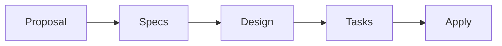

# Documentation Guide

이 문서는 `openspec-schemas` 저장소의 문서 작성 표준과 체계를 안내합니다. 일관되고 명확한 문서는 AI 에이전트와 개발자가 스키마를 올바르게 이해하고 유지보수할 수 있도록 돕습니다.

## Documentation Levels

문서는 관리 범위와 목적에 따라 저장소 레벨과 스키마 레벨로 구분합니다.

### 1. Repository-Level Documentation (`docs/`)

저장소 전반에 적용되는 공통 원칙과 개발/문서화 표준을 다룹니다.

- [language.md](language.md): 문서 및 메타데이터의 한국어/영어 사용 기준
- [development.md](development.md): 스키마 개발 표준 및 워크플로우 가이드
- [documentation.md](documentation.md): 문서 작성 기준 및 스타일 가이드
- [README.md](README.md): 공통 문서 인덱스

### 2. Schema-Level Documentation (`openspec/schemas/<schema-name>/`)

개별 커스텀 스키마의 구조, 의도, 아키텍처 및 변경 이력을 다룹니다.

- **`README.md`**: 사용자 및 에이전트용 개요 문서. 스키마 목적, 워크플로우 요약 다이어그램, 주요 특징을 설명합니다.
- **`docs/architecture.md`**: 아티팩트 간의 책임 분리, 설계 근거(Rationale), 계약 소유권(Contract Ownership)을 상세히 기술합니다.
- **`docs/baseline.md`**: 장기적으로 보존해야 할 요구사항(Requirements), 설계 결정(Decisions), 불변 조건(Invariants), 변경 기록(Change Record)을 표 형태로 관리합니다.
- **`docs/README.md`**: 스키마 문서들의 역할 및 유지보수 규칙을 안내합니다.

## Authoring Standards

### Language Policy

[language.md](language.md)의 원칙을 엄격히 준수합니다.

- **Title & Section Heading**: English (e.g. `# Documentation Guide`, `## Overview`)
- **Prose & Descriptions**: 한국어를 기본으로 하되, 기술 용어나 원래 표기가 자연스러운 경우 영어를 유지합니다.
- **Identifiers & Paths**: 영어 및 원본 표기 유지 (e.g. `schema.yaml`, `proposal.md`)

### Mermaid Diagrams

워크플로우 및 의존성 관계는 Mermaid 다이어그램을 활용해 시각화합니다.



- 노드 라벨에는 아티팩트 이름과 핵심 책임을 간결히 명시합니다.
- 조건부 흐름(e.g. `skip_specs: true`)이나 참조 관계는 점선 또는 주석 링크로 표현합니다.

### Baseline Management

`baseline.md` 문서는 스키마가 진화할 때 drift를 막는 핵심 기준점입니다.

- **ID 체계**: Requirements(`R-xxx`), Decisions(`D-xxx`), Invariants(`I-xxx`)로 넘버링하여 상호 참조합니다.
- **Table 형식**: ID, 내용, 근거(Rationale)를 명확한 마크다운 테이블로 작성합니다.
- **Change Record**: 스키마 구조 변경 시 이전 baseline과의 차이점, 해결한 문제, 호환성 영향, 기각된 대안을 기록합니다.

## Markdown Style & Formatting

이 저장소는 `.rumdl.toml` 린터 설정을 따릅니다.

- **Headings**: ATX 스타일 (`#`, `##`, `###`)을 사용합니다.
- **Lists**: 순서 없는 목록은 대시(`-`)를 기본으로 사용합니다.
- **Code Fences**: 백틱(```` ``` ````) 기반의 fenced code block을 사용하며, 언어 식별자(e.g. `yaml`, `markdown`, `text`, `mermaid`)를 지정합니다.
- **Links**: 워크플로우 문서 및 파일 참조 시 표준 마크다운 링크 형식(`[path/file.md](path/file.md)`)을 사용합니다.
- **Tables**: GFM 스타일의 정렬된 테이블을 사용합니다.

## Template In-file Documentation

템플릿 파일([templates/](../openspec/schemas/spec-driven-tdd/templates/)) 내부에는 HTML 주석(`<!-- ... -->`)을 사용하여 작성 규칙을 내장합니다.

- **작성 규칙**: 각 섹션의 목적과 작성 시 주의사항을 명시합니다.
- **선택적 섹션(Optional Sections)**: 불필요한 경우 섹션 전체를 삭제할 수 있는 기준을 안내합니다.
- **파서 계약 보호**: 파서가 인식해야 하는 필수 헤딩과 포맷은 수정하지 않도록 안내합니다.
